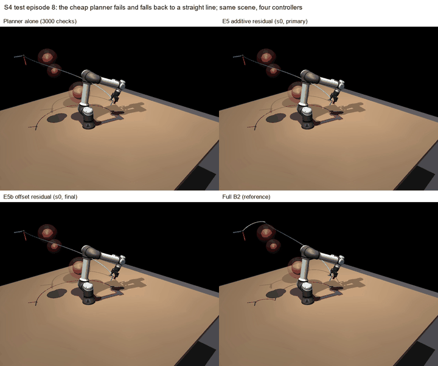
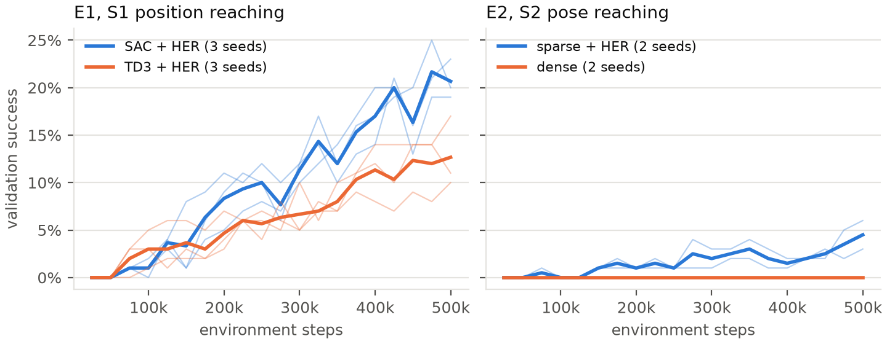
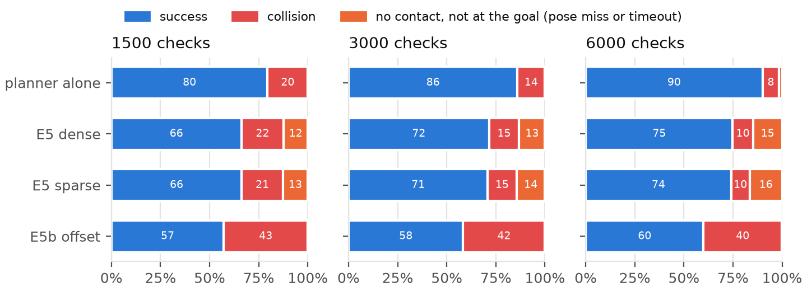
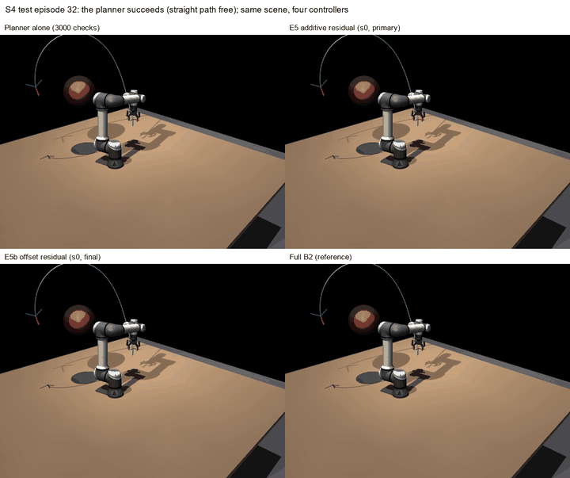
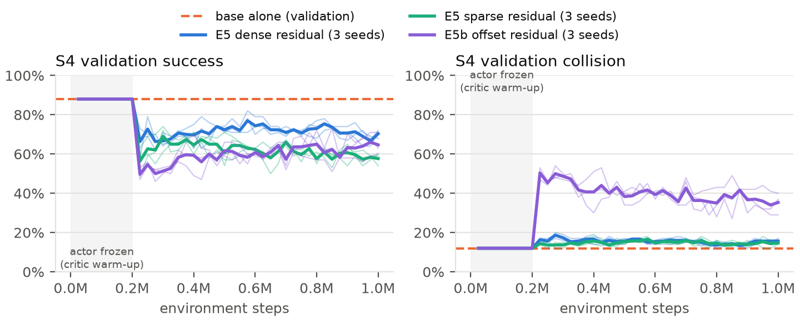
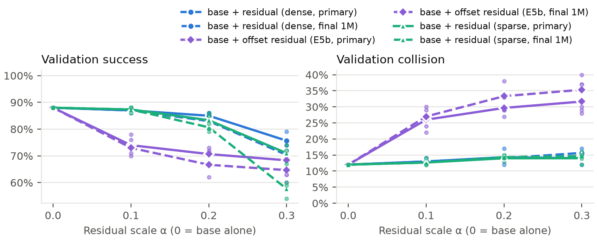
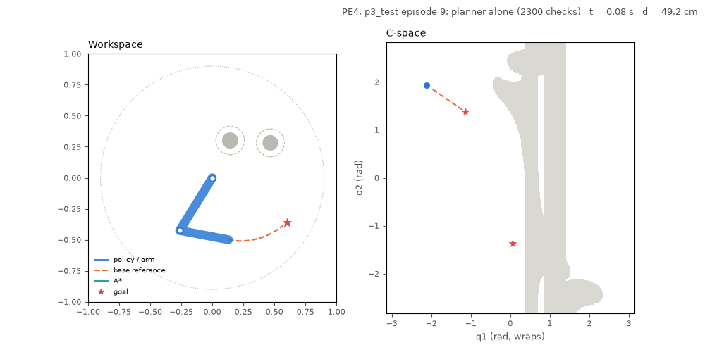
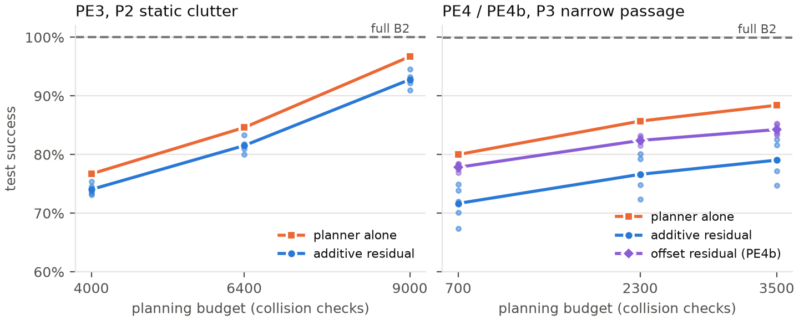
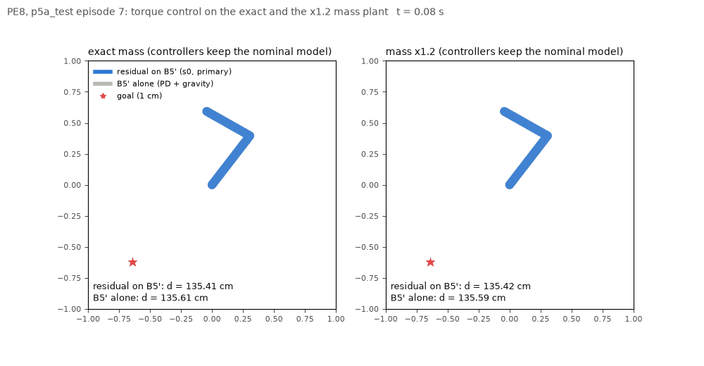

# Planner-Guided Residual RL for Manipulator Motion Planning

*Can a cheap motion planner plus a learned correction match an expensive planner? A UR5e study with a planar 2-DOF
companion.*

**Bhuvan Raj Guguloth** · M.Tech project (MTP), IIT Kharagpur · October 2026

MuJoCo 3.17 · Stable-Baselines3 2.9.2 · PyTorch (CPU) · Python 3.11 · simulation only

<p align="center">
  <a href="results/videos/ep8_side_by_side.mp4"></a><br>
  <sub><b>S4 test episode 8</b>, one cluttered scene and four controllers. The cheap planner runs out of budget and falls
  back to a straight line through the obstacles. Neither learned residual steers off it, and only full RRT-Connect
  (bottom right) reaches the goal. Click for the full-resolution MP4.</sub>
</p>

---

## Contents

1. [Summary](#1-summary)
2. [Problem and research questions](#2-problem-and-research-questions)
3. [System](#3-system)
4. [Method: cheap planner + learned residual](#4-method-cheap-planner--learned-residual)
5. [Experimental protocol](#5-experimental-protocol)
6. [Results: reaching without obstacles (E1, E2)](#6-results-reaching-without-obstacles-e1-e2)
7. [Results: motion planning in clutter (E5, E5b)](#7-results-motion-planning-in-clutter-e5-e5b)
8. [Why the residual fails: the authority–safety dilemma](#8-why-the-residual-fails-the-authoritysafety-dilemma)
9. [Planar 2-DOF companion study](#9-planar-2-dof-companion-study)
10. [Three silent failures in goal-conditioned training](#10-three-silent-failures-in-goal-conditioned-training)
11. [Limitations and future work](#11-limitations-and-future-work)
12. [Reproducing the results](#12-reproducing-the-results)
13. [Repository layout](#13-repository-layout)
14. [Figures and videos index](#14-figures-and-videos-index)
15. [References](#15-references)

---

## 1. Summary

The project asks whether a **sampling-based planner with a small computation budget**, combined with a **learned
residual correction (SAC)**, can match a **full-budget planner** for collision-free 6D pose reaching on a simulated
UR5e with a Robotiq 2F-85 gripper.

**Answer: no, not in this setup.** On 200 held-out cluttered scenes:

- full RRT-Connect (B2) succeeds in **99.0%** of episodes;
- the same planner limited to 1,500–6,000 collision checks succeeds in **79.5–90.0%**;
- adding the learned residual **lowers** success at every budget, to **66–75%**.

| S4 test set, 3000 collision checks | Success | Collision | What goes wrong |
|---|---:|---:|---|
| Full RRT-Connect, B2 (reference) | **99.0%** | 0.5% | — |
| Cheap planner alone | **86.0%** | 14.0% | budget runs out, straight-line fallback hits obstacles |
| + additive residual (E5, dense reward) | 71.5% | 15.3% | collisions unchanged, plus 13.5% goal-pose misses |
| + additive residual (E5, sparse reward) | 70.8% | 14.7% | same |
| + accumulated-offset residual (E5b) | 58.3% | **41.7%** | the offset saturates and pushes the arm into obstacles |
| Pure SAC + HER, no planner | 0.0% | 53.8% | never learns the task in 1M steps |

The two residual designs fail in opposite ways. We call this the **authority–safety dilemma**:

- **Too little authority (E5).** The tracking controller cancels an additive correction at every step. The residual
  can move the arm at most α·Δq_max = **0.012 rad** off the plan: too little to avoid an obstacle, but enough to miss
  a 1 cm / 5° goal.
- **Too little safety (E5b).** A persistent offset has the authority to steer, but the policy drives it to its
  ±0.3 rad limit, and collisions rise **2–5×** above the planner's.

A **planar 2-DOF arm** reproduces the headline result: the hybrid is below its planner in all three companion
experiments. Its design rankings agree with the UR5e on **8 of 9** comparisons. The exception is the offset
redesign, which helps on the planar arm and hurts on the UR5e. The only setting where a residual improves on its
base is **torque control under a ±20% mass error**: there it roughly doubles success, but it gives up most of the
performance on the exact plant.

Along the way, three bugs broke training without raising any error. Each is documented with a tested fix
([§10](#10-three-silent-failures-in-goal-conditioned-training)).

---

## 2. Problem and research questions

Sampling-based planners such as RRT-Connect find collision-free paths reliably when given enough computation, but
their success falls as the budget shrinks. Residual RL proposes a way around this: keep a cheap classical
controller and let a learned policy add small corrections where it falls short (Silver et al., 2018; Johannink et
al., 2019). Neither of those works studies a base that **tracks a planned path**, where the tracker itself may undo
the correction.

| | Question | Experiment |
|---|---|---|
| RQ1 | Which off-policy algorithm learns 6D reaching best under a fixed budget: SAC or TD3 (with HER)? | E1, PE1 |
| RQ2 | Do sparse rewards with HER beat dense shaped rewards? | E2, PE2 |
| RQ3 | Can a learned residual on a cheap RRT-Connect planner match the full planner's success and collision rate? | **E5, E5b**, PE3, PE4, PE4b |
| P-RQ | Does a residual help where the base has a *systematic* model error (torque control, wrong masses)? | PE8 |
| Transfer | Do design rankings from the cheap planar arm predict the UR5e? | PE9-lite |

Every design decision, deviation and shortfall was recorded in a versioned specification **before** the result it
affects was seen: [SPEC.md](SPEC.md) (UR5e, v0.25) and [2-dof/SPEC.md](2-dof/SPEC.md) (2-DOF, v0.12). Findings
and their reasoning are logged, dated, in [docs/thesis_notes.md](docs/thesis_notes.md).

---

## 3. System

### Robot and simulation

| | |
|---|---|
| Arm | Universal Robots UR5e (MuJoCo Menagerie model), 6 position-servoed joints, gravity compensation on (as the real controller) |
| Gripper | Robotiq 2F-85, welded open as one rigid 1.05 kg body; tool point 14.16 cm from the flange |
| Physics | 0.002 s timestep, frame skip 20, so 25 Hz control |
| Action | $a \in [-1,1]^6$ integrated into the joint target: $q_\text{target} \leftarrow \mathrm{clip}(q_\text{target} + a\,\Delta q_\max)$, $\Delta q_\max = 0.04$ rad (≈ 0.98 rad/s) |
| Observation | joint angles (sin/cos, normalized), velocities, tool position and 6D rotation, previous action, $q_\text{target}-q$; obstacle stages add 4 obstacle slots (center, radius, mask) and the clearance of 6 links + gripper |
| Goal | 9-D: position plus the first two rotation-matrix columns (Zhou et al., 2019), sampled in joint space so every goal is reachable |
| Success | tool within **1 cm and 5°** of the goal (S1: 2 cm, position only) |

### Task stages

| Stage | Task | Obstacles | Horizon | Used in |
|---|---|---|---|---|
| S1 | reach a position | none | 150 steps (6 s) | E1 |
| S2 | reach a pose | none | 175 steps (7 s) | E2 |
| S4 | reach a pose | 1–4 random spheres per episode | 407 steps (16.3 s) = 1.25 × p99 of full-planner path duration | E5, E5b |

### Baselines

| | |
|---|---|
| **B1** | analytic IK + quintic joint trajectory at the speed limit (S1/S2) |
| **B2** (full planner) | RRT-Connect in joint space, exact obstacles, 2 s cap, edge checks every 0.01 rad, 200 shortcut iterations, quintic time-scaling |
| **Base@N** (cheap planner) | RRT-Connect with **N ∈ {1500, 3000, 6000} collision checks**, obstacles inflated by 5 cm, 20 shortcuts; if planning fails it **falls back to a straight joint-space line** that ignores obstacles |
| **Pure RL** | SAC + HER from scratch, no planner |

---

## 4. Method: cheap planner + learned residual


The tracker feeds the next reference point forward from the current joint target:

$$a_\text{base} = \mathrm{clip}\!\left(\frac{q_\text{ref}(t+1) - q_\text{target}}{\Delta q_\max},\,-1,\,1\right)$$

**E5: additive residual.** The policy's output is scaled and added to the base command:

$$a = \mathrm{clip}\big(a_\text{base} + \alpha\,\pi_\text{res}(s),\,-1,\,1\big)$$

**E5b: accumulated offset.** The correction integrates into a persistent joint offset that can steer away from the
reference. The offset fades out near the goal and over the last 10% of the reference:

$$o_t = \mathrm{clip}\big(o_{t-1} + \alpha\,\pi_\text{res}(s)\,\Delta q_\max,\,\pm 0.3\big),\qquad q_\text{target} = q_\text{ref} + f_t\,o_t$$

**Training safeguards, shared by both designs:**
- **Start from the base.** α ramps from 0 to 0.3 over 150k steps; the actor's mean starts near zero with log-std bias −3.
- **Critic first.** Only the critic trains for the first 50k gradient steps, so the actor stays frozen for about 200k environment steps.
- **Penalize large corrections:** $w_\text{res} = 0.1$ on $\|\pi_\text{res}\|^2$ (E5) or on $\|o/0.3\|^2$ (E5b).
- **Random budget.** The planning budget is drawn per episode from {1500, 3000, 6000}.
- **No HER.** A relabeled goal would not match the reference that was planned for the original goal.

**Collisions** end the episode with an absorbing penalty, so crashing is always worse than timing out
([§10](#10-three-silent-failures-in-goal-conditioned-training)):

$$R_\text{coll} = \frac{r_\min}{1-\gamma} - w_c \qquad (r_\min = -3.95 \text{ sparse},\ -6.54 \text{ dense})$$

---

## 5. Experimental protocol

| Experiment | Stage | Compares | Seeds × steps |
|---|---|---|---|
| E1 | S1 | TD3 + HER vs SAC + HER | 3 × 500k |
| E2 | S2 | SAC sparse + HER vs SAC dense | 2 × 500k |
| **E5** | S4 | pure SAC + HER; residual SAC with dense and with sparse reward | 3 × 1M each |
| **E5b** | S4 | accumulated-offset residual (pre-registered; v2 final) | 3 × 1M |
| PE1–PE8 | planar arm | the same questions on a 2-DOF arm ([§9](#9-planar-2-dof-companion-study)) | 5–10 × 50k–300k |

- **Shared settings.** 3×256 networks, batch 256, 4 parallel environments, 0.25 gradient steps per transition. γ is 0.98 with HER ("future", k = 4) and 0.99 without. Replay buffers hold 500k transitions (E1, E2) or 1M (E5, E5b). Learning rates are 3e-4 for SAC and 1e-3 for TD3.
- **Test sets.** Frozen before training, with disjoint seed ranges. S4 has 200 test episodes; each stage also has a separate 100-episode validation set used for model selection.
- **Checkpoint rule.** A residual run is evaluated at two checkpoints:
  - **primary:** the best validation score after the α ramp and critic warm-up have both finished, so selection can't pick an untrained residual (which is identical to the base);
  - **final:** the 1M checkpoint.
- **Statistics.**
  - Trained methods report the seed mean with a 95% bootstrap interval over seeds, plus a pooled Wilson interval over all test episodes (episode-level variation only).
  - Planners are deterministic, so they report the Wilson interval alone.
- **Compute.** CPU only: an i5-1240P laptop plus free Colab and Kaggle sessions. A 1M-step run took 1.5–5.3 h (52–189 steps/s). Offloaded seeds were merged back with config-hash checks ([scripts/merge_cloud_runs.py](scripts/merge_cloud_runs.py)).

---

## 6. Results: reaching without obstacles (E1, E2)

<p align="center"></p>

| | Success (per seed) | Final position error | Notes |
|---|---|---|---|
| **E1** SAC + HER | **20.7%** (19 / 23 / 20) | 22.2 cm | stuck short of the goal in 60% of failures |
| **E1** TD3 + HER | 12.7% (11 / 17 / 10) | 29.1 cm | stuck in 49% of failures |
| **E2** sparse + HER | **4.5%** (3 / 6) | 35.4 cm | touches the table or itself in 38.5% of episodes (S2 has no contact penalty) |
| **E2** dense | 0.0% (0 / 0) | 30.2 cm | ends closer to the goal, but never within 1 cm / 5° |

All values are final validation at 500k steps, 100 episodes per seed: [e1.md](results/tables/e1.md),
[e2.md](results/tables/e2.md).

- **RQ1:** SAC beats TD3.
- **RQ2:** sparse + HER beats dense on success, but not on final error.
- **Both fall far short** of their targets (≥ 95% and ≥ 90%). They are reported as shortfalls under the project's
  one-week rule: they show what pure RL achieved on this budget, not what SAC can reach with more steps.
- **Discount factor.** A γ = 0.95 pilot (effective horizon ~20 steps, versus ~80 needed for a 3.2 rad move) stalled
  at 0–6%. γ was then chosen from the task's step horizon.

---

## 7. Results: motion planning in clutter (E5, E5b)

<p align="center"></p>

S4 test set, 200 episodes per seed, success / collision in %. Trained arms show the mean over 3 seeds at the primary
checkpoint (final 1M checkpoint in brackets). Full table with intervals: [results/tables/e5.md](results/tables/e5.md).

| Method | 1500 checks | 3000 checks | 6000 checks |
|---|---|---|---|
| Full B2 (reference) | 99.0 / 0.5 | 99.0 / 0.5 | 99.0 / 0.5 |
| Cheap planner alone | **79.5** / 20.5 | **86.0** / 14.0 | **90.0** / 8.5 |
| E5 dense residual | 66.2 [61.5] / 21.5 | 71.5 [66.5] / 15.3 | 74.8 [69.7] / 10.3 |
| E5 sparse residual | 66.3 [59.8] / 21.0 | 70.8 [64.2] / 14.7 | 74.0 [67.2] / 9.5 |
| E5b offset residual | 57.2 [59.3] / 42.8 | 58.3 [62.0] / 41.7 | 60.0 [63.8] / 39.8 |
| Pure SAC + HER | 0.0 / 53.8 | — | — |

- **The gap is not noise.** At 6000 checks the dense hybrid's 95% seed interval is 72.0–77.0%, entirely below the
  planner's episode-level interval of 85.1–93.4%.
- **More training makes E5 worse.** The final checkpoint is below the primary in every E5 arm and budget. E5b's final
  checkpoint is slightly better than its primary, but still far below the planner.

<p align="center"></p>

E5's lost successes are almost all **pose misses**: the episode ends without contact but outside the goal tolerance.
E5b's are **collisions**.

<p align="center">
  <a href="results/videos/ep32_side_by_side.mp4"></a><br>
  <sub><b>S4 test episode 32</b>: the straight path is free, so the planner alone and B2 both succeed at 8.4 s. The E5
  hybrid stops 1.1 cm / 1.4° from the goal (a pose miss), and the E5b hybrid steers into the only obstacle.
  Click for the MP4.</sub>
</p>

---

## 8. Why the residual fails: the authority–safety dilemma

<p align="center"></p>

Every residual seed sits exactly on the planner's validation line (88% / 12%) while its actor is frozen. Each drops
below that line as soon as the actor starts to train, and none recovers by 1M steps.

**E5 has no authority (measured).**
- **The tracker cancels the residual.** It re-aims at $q_\text{ref}(t+1)$ every step, taking back whatever the
  residual added the step before. On every unsaturated step (87% of steps) the residual moves the target by at most
  $\alpha\,\Delta q_\max = 0.0120$ rad.
- **Collisions are the planner's.** At each budget the hybrid's collision rate is within 2 points of the planner's.
  Its whole loss is pose misses: 12.7–15.8% of episodes, against 0–0.5% for the planner.
- **It spoils the goal pose.** On episodes where both avoid contact, the planner ends 0.41 cm / 0.9° from the goal
  and the hybrid 0.72–0.75 cm / 1.3°, enough to fail a 1 cm / 5° test.
  ([e5_diagnostic.md](results/tables/e5_diagnostic.md))

**E5b has authority but saturates (measured).** The offset ends episodes at a median of 0.26–0.30 rad, at or near
its ±0.30 clip, in failures and successes alike. Across seeds and checkpoints, 87–96% of collisions happen with
|o| ≥ 0.15 rad.

<p align="center"></p>

**The α sweeps agree.** Fixing α at evaluation time:
- E5's validation success falls monotonically from 0.88 at α = 0 (the planner alone) to 0.76 at α = 0.3, so the
  residual never helps at any scale;
- E5b already drops to 0.70–0.78 at α = 0.1, because α sets only how fast the offset moves, not its limit.

**Reading.** A correction bounded tightly enough to stay on the planner's safe path cannot fix the planner's failures.
One free enough to fix them leaves the safe path. Neither learned the selective behaviour the claim needs: do nothing
in the 80–90% of episodes where the planner succeeds, and act only where it fails.

**E5b design history**, with every change decided on validation evidence before any test-set evaluation:
- **v0:** wrong units, archived.
- **v1:** the distance-only fade never engaged, since the saturated offset kept the tool ~24 cm away. Archived.
- **v2:** time-based fade plus an offset penalty. Declared final before its results were known.

---

## 9. Planar 2-DOF companion study

A planar 2-link arm with an exactly computable C-space serves as a fast, interpretable testbed. It also allows a
best-known path length for every episode ([2-dof/SPEC.md](2-dof/SPEC.md)).

<p align="center"></p>
<p align="center"><sub><b>PE4, narrow-passage stage P3.</b> Workspace (left) and C-space (right, gray = configurations
in collision). Test episode 9: the planner alone succeeds, and the hybrid stops 1.26 cm short. Test episode 0: both
follow the straight-line fallback into the obstacle.</sub></p>

**Algorithm and reward choices (PE1, PE2; 10 seeds × 50k steps, validation success)**

| | Success |
|---|---|
| SAC + HER | **78.8%** |
| TD3 + HER | 63.6% |
| DDPG + HER | 42.1% |
| PPO, dense | 0.0% |
| SAC sparse + HER, no curriculum | 71.0% |
| SAC dense, with / without curriculum | 5.3% / 2.0% |

**Planner + residual in clutter (PE3, PE4, PE4b; 5 seeds, 1000 test episodes, primary checkpoint)**

<p align="center"></p>

| | Budgets | Planner alone | Additive residual | Offset residual (PE4b) | Pure SAC + HER | Full B2 |
|---|---|---|---|---|---|---|
| PE3, P2 clutter | 4000 / 6400 / 9000 | 76.7 / 84.6 / 96.7 | 74.0 / 81.5 / 92.8 | — | 1.1 | 100.0 |
| PE4, P3 narrow passage | 700 / 2300 / 3500 | 80.0 / 85.7 / 88.4 | 71.7 / 76.6 / 79.0 | 77.8 / 82.4 / 84.3 | 0.2 | 99.9 |

- **Same pattern as E5.** The additive hybrid is below its planner at every budget, with the planner's collision
  rate. The gap grows with task difficulty: 1–4 points on PE3, 8–9 on PE4, 12–15 on the UR5e.
- **The offset helps on the planar arm.** It beats the additive residual by 5.8 points, but stays 3.3 points below
  the planner, with 2–4 points more collisions and ~10% longer paths.
- Tables: [pe3.md](results/tables/pe3.md), [pe4.md](results/tables/pe4.md).

**Torque control under model error (PE8; 5 seeds, 300 test episodes)**

<p align="center"></p>

| | Exact mass | Mass ×0.8 | Mass ×1.2 |
|---|---:|---:|---:|
| B5, computed torque | 100.0 | 10.3 | 10.7 |
| B5', PD + gravity | 100.0 | 19.0 | 15.3 |
| **Residual on B5'** | 43.0 | **33.0** | **30.3** |
| Pure SAC + HER | 0.1 | 0.1 | 0.1 |

- **The one place a residual beats its base.** The base's gravity term is systematically wrong on the perturbed
  plants, and there the residual roughly doubles success.
- **It costs most of the exact-plant performance:** 100% → 43%.
- Figure: [pe8_plants.png](results/figures/pe8_plants.png); table: [pe8.md](results/tables/pe8.md).

**Do planar rankings transfer to the UR5e? (PE9-lite)**

| Design choice | 2-DOF | UR5e | Same ranking? |
|---|---|---|---|
| SAC vs TD3 (+HER) | +15.2 points | +8.0 | yes |
| sparse + HER vs dense | +73.5 | +4.5 | yes |
| goal-distance curriculum on vs off | +7.8 | +7.0 (1-seed probe) | yes |
| hybrid vs planner alone (PE3 / PE4 vs E5) | −3.1 / −9.1 | −14.5 | yes, yes |
| hybrid vs pure RL (PE3 / PE4 vs E5) | +80.4 / +76.4 | +71.5 | yes, yes |
| **offset vs additive residual** | **+5.8** | **−13.2** | **no** |
| offset hybrid vs planner alone | −3.3 | −27.7 | yes |

**8 of 9 rankings agree** ([pe9_lite.md](results/tables/pe9_lite.md)). The cheap testbed predicted the training
choices and the headline result. It did not predict how much the offset redesign costs in safety, which is exactly the
part that depends on geometry: a 2-D C-space, against 1–4 spheres around a 6-DOF arm.

---

## 10. Three silent failures in goal-conditioned training

Each of these produced no error and looked like an algorithm that simply wasn't learning. All three share one cause:
anything in a transition that depends on the goal, or is lost when the goal is relabeled, must be recomputed or
carried along with it.

| # | Defect | Symptom | Fix (tested) |
|---|---|---|---|
| 1 | Goal errors (goal − tool) inside the observation | HER relabels the goal but not the errors, so ~80% of training samples point at the wrong goal; E1 stayed at 0% after 120–160k steps | goal-independent observation; errors computed inside the policy from whichever goal is in use (`GoalErrorExtractor`) |
| 2 | SB3's HER buffer passes empty info dicts by default | collision and clearance penalties vanish from relabeled rewards | `SafetyHerReplayBuffer` stores the goal-independent term as one float (8 B) per transition and adds it back on every relabel; `compute_reward` raises on missing terms |
| 3 | A collision ended the episode with a one-off −10 | staying alive cost ≈ −50 discounted, so crashing at step 9 (≈ −17) paid better; pure SAC crashed in 100% of episodes | absorbing penalty $R_\text{coll} = r_\min/(1-\gamma) - w_c$, tested so crashing is worse than surviving any number of steps |

---

## 11. Limitations and future work

**Limitations**
- **Budget.** 500k–1M steps per run, 2–5 seeds, 0.25 gradient steps per transition, CPU only. More steps or updates
  could change E1, E2 and the residual results.
- **Simulation only.** Spherical obstacles at known positions, no perception, no real robot.
- **One base design.** A single degraded RRT-Connect with a straight-line fallback; a different base could leave the
  residual more room.
- **Untuned weights.** Dense-reward weights and $w_\text{res}$ were set once, not swept.
- **Gap metric.** The 2-DOF best-known path is not a strict lower bound: executed paths are measured only up to
  the 1 cm success ball, which biases absolute gaps by about −0.8%
  ([appendix note](docs/thesis_notes.md#appendix-note-2026-10-30--why-the-best-known-path-length-is-not-a-strict-lower-bound)).
- **PE8 checkpoints.** PE8's primary and final checkpoints coincide: the runs are 300k steps long and checkpoints are kept every 100k.

**Future work**
- **Gated residual.** Act only near predicted conflicts (low clearance on the planned path), so the default is the
  planner.
- **Safety-filtered residual.** Project the correction onto clearance-preserving actions (control barrier function,
  or a Lagrangian collision constraint).
- **TD3 for integrated actions.** A deterministic actor with decaying noise, to test whether max-entropy noise drives
  the offset to saturation.
- **Demonstrations.** Pre-train the residual on corrections derived from the full planner.
- **Real arm.** URSim, then a UR5e with a depth camera feeding the planner a perceived obstacle map.

---

## 12. Reproducing the results

### Setup

```bash
py -3.11 -m venv .venv
.venv/Scripts/python -m pip install --index-url https://download.pytorch.org/whl/cpu torch==2.14.1
.venv/Scripts/python -m pip install -r requirements.lock
.venv/Scripts/python -m pip install -e ".[dev,viz]"   # viz: MP4 / GIF recording
.venv/Scripts/python -m pip install -e 2-dof           # planar-arm package (shares agents with ur5rl)
```

### Tests and environment checks

```bash
python -m pytest              # UR5e suite (75 tests)
python -m pytest 2-dof        # 2-DOF suite (74 tests)
python scripts/bench_throughput.py --mode dense --threads 1   # throughput gate, run once per machine type
```

### Training

Model checkpoints are not in the repository (~13 GB). Each run's exact configuration is in
`results/runs/<exp>/<run>/config.json`. Finished runs are skipped, and interrupted runs resume.

```bash
python scripts/train.py  --exp configs/exp/e5.yaml --run residual --seed 0
python scripts/launch.py --exp configs/exp/e5.yaml --workers 2 --threads 1
python scripts/launch.py --exp 2-dof/configs/exp/pe4.yaml --workers 2 --threads 1
```

### Evaluation, tables and figures

The per-episode test rows are versioned in `results/eval/`, so the tables and figures rebuild without retraining:

```bash
python scripts/e5_table.py                  # results/tables/e5.md, e5.csv
python scripts/e5_diagnostic.py --report    # results/tables/e5_diagnostic.md
python scripts/e2_table.py --exp e1         # e1.md (without --exp: e2.md)
python 2-dof/scripts/pe_tables.py           # pe3.md, pe4.md
python 2-dof/scripts/pe9_lite.py            # pe9_lite.md
python scripts/plot_budget.py               # e5_budget_s4_test.*
python scripts/plot_alpha_sweep.py          # e5_alpha_sweep.*
python scripts/thesis_figures.py            # learning curves, validation curves, outcome split, PE3/PE4, PE8
```

Re-evaluating from trained models: `scripts/evaluate.py` (UR5e: b1, b2, base@N, hybrid@N, policy),
`2-dof/scripts/evaluate.py` and `2-dof/scripts/eval_pe8.py`.

### Viewers (require trained models locally)

Replay a frozen test episode exactly as it was evaluated:

```bash
# UR5e, S4 test episode with obstacles, reference path and tool trail drawn
python scripts/play.py --testset s4_test --episode 8 --method base   --budget 3000
python scripts/play.py --testset s4_test --episode 8 --method hybrid --budget 3000 --run results/runs/e5/residual_ff20115a_s0 --checkpoint primary
python scripts/play.py --testset s4_test --episode 8 --method hybrid --budget 3000 --run results/runs/e5b/residual_offset_4f49c707_s0 --checkpoint final
python scripts/play.py --testset s4_test --episode 8 --method b2 --record results/videos/ep8_4_b2.mp4

# planar arm, workspace + C-space
python 2-dof/scripts/play.py --run results/runs/pe4/residual_dd445192_s0 --checkpoint primary --testset p3_test --episode 9 --budget 2300
python 2-dof/scripts/play.py --stage p3 --policy base --testset p3_test --episode 9 --budget 2300
python 2-dof/scripts/play.py --run results/runs/pe8/residual_787d568a_s0 --checkpoint primary --testset p5a_test --episode 7 --mass 1.2
```

Keys:
- **R** replay the episode;
- **N** next test episode;
- **P** pause;
- **B** residual on/off;
- 2-DOF only: **A** show the A* path, **V** value-function heatmap.

Media: `scripts/side_by_side.py --episode N` builds the UR5e grid video, and `2-dof/scripts/make_gifs.py` builds
the planar GIFs.

---

## 13. Repository layout

```text
SPEC.md                 UR5e specification: tasks, env, rewards, baselines, protocol, every decision (versioned)
src/ur5rl/              UR5e package
  envs/                 pose env, residual env (additive / offset), clearance
  agents/               SAC/TD3 factory, SafetyHerReplayBuffer, GoalErrorExtractor, residual SAC
  planners/             analytic IK, RRT-Connect, shortcutting, quintic time-scaling, B1/B2
  eval/                 test sets, metrics, summary locking
configs/                agent / env (S1, S2, S4) / experiment YAMLs
scripts/                train, launch, evaluate, tables, figures, diagnostics, viewer, pipelines, cloud merge
testsets/               frozen test and validation episodes (.npz) + summary.json
tests/                  pytest suite (UR5e)
assets/                 MuJoCo scene; vendored Menagerie UR5e + Robotiq 2F-85 (commit in assets/menagerie/COMMIT)
notebooks/              Colab / Kaggle runners for offloaded seeds
2-dof/                  planar companion: own SPEC, package arm2dof (kinematic + torque envs, C-space, A*),
                        configs, scripts, tests, test sets
docs/thesis_notes.md    dated findings, design rationale, appendix notes
results/
  tables/               result tables (Markdown / CSV)
  figures/              thesis figures (PDF / PNG)
  videos/               replays (MP4 / GIF)
  eval/                 per-episode test-set rows (*.jsonl) and summary.json per test set
  runs/                 per-run config.json, done.json, validation curves, α sweeps, diagnostics
```

---

## 14. Figures and videos index

| Figure | Shows |
|---|---|
| [learning_curves_e1_e2](results/figures/learning_curves_e1_e2.png) | E1 / E2 validation success vs steps |
| [e5_budget_s4_test](results/figures/e5_budget_s4_test.png) | **Headline:** S4 test success and collision vs planning budget |
| [e5_outcome_split](results/figures/e5_outcome_split.png) | S4 test outcome per arm and budget |
| [e5_validation_curves](results/figures/e5_validation_curves.png) | residual arms on S4 validation, against the planner's line |
| [e5_alpha_sweep](results/figures/e5_alpha_sweep.png) | validation success and collision vs residual scale α |
| [pe34_budget](results/figures/pe34_budget.png) | 2-DOF PE3 / PE4 / PE4b test success vs budget |
| [pe8_plants](results/figures/pe8_plants.png) | 2-DOF torque control on the exact and ±20% mass plants |

All figures are also available as PDF in [results/figures/](results/figures/).

| Video | Shows |
|---|---|
| [ep8_side_by_side.mp4](results/videos/ep8_side_by_side.mp4) | S4 episode 8 (planner fails): planner alone, E5, E5b, full B2 |
| [ep32_side_by_side.mp4](results/videos/ep32_side_by_side.mp4) | S4 episode 32 (planner succeeds): same four controllers |
| `results/videos/ep{8,32}_{1-4}_*.mp4` | the eight single-controller replays the grids are built from |
| [pe4_p3_test.gif](results/videos/pe4_p3_test.gif) | 2-DOF PE4: planner alone vs additive hybrid, workspace + C-space |
| [pe8_exact_vs_mass1.2.gif](results/videos/pe8_exact_vs_mass1.2.gif) | 2-DOF PE8: residual vs PD + gravity, exact vs ×1.2 mass |

---

## 15. References

- Agarwal, R. et al. (2021). Deep RL at the edge of the statistical precipice. arXiv:2108.13264.
- Andrychowicz, M. et al. (2017). Hindsight Experience Replay. arXiv:1707.01495.
- Fujimoto, S., van Hoof, H., Meger, D. (2018). Addressing function approximation error in actor-critic methods (TD3). arXiv:1802.09477.
- Haarnoja, T. et al. (2018). Soft Actor-Critic. arXiv:1801.01290.
- Johannink, T. et al. (2019). Residual reinforcement learning for robot control. ICRA 2019, arXiv:1812.03201.
- Kuffner, J., LaValle, S. (2000). RRT-Connect: an efficient approach to single-query path planning. ICRA 2000.
- Silver, T. et al. (2018). Residual Policy Learning. arXiv:1812.06298.
- Zhou, Y. et al. (2019). On the continuity of rotation representations in neural networks. CVPR 2019, arXiv:1812.07035.
- MuJoCo Menagerie: UR5e and Robotiq 2F-85 models (vendored in `assets/menagerie/`, upstream licences apply).
