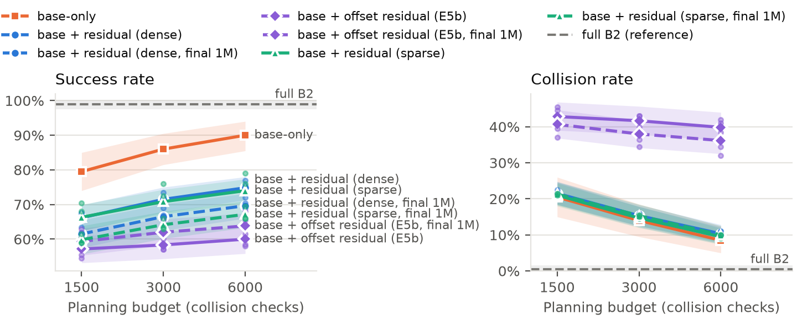

# Planner-guided residual RL for manipulator motion planning (UR5e + planar 2-DOF)

MTP thesis project: can a **cheap sampling-based planner plus a learned residual correction** match an expensive
planner for collision-free 6D pose reaching? Simulated in MuJoCo on a **UR5e with a Robotiq 2F-85**, with a
**planar 2-DOF arm** as a methodology-validation companion. Every design decision, deviation and result is recorded
in the versioned specs: [SPEC.md](SPEC.md) (UR5e, v0.25) and [2-dof/SPEC.md](2-dof/SPEC.md) (2-DOF, v0.12).

## Result in one paragraph

**No, not in this setup.** On 200 held-out cluttered S4 scenes, full RRT-Connect (B2) succeeds in 99.0% of episodes.
The same planner limited to 1,500–6,000 collision checks succeeds in 79.5–90.0%, and adding a learned SAC residual
*lowers* success at every budget. Two residual designs fail in opposite ways, the **authority–safety dilemma**:

- **E5, additive residual:** the tracking controller cancels the correction every step, so it can move the target at
  most α·Δq_max = 0.012 rad from the plan. Too little to avoid obstacles, enough to miss the 1 cm / 5° goal.
  Collisions stay at the planner's level, and the lost successes are pose misses.
- **E5b, accumulated offset:** the persistent offset has the authority to steer, but the policy drives it to its
  ±0.3 rad limit, and collisions rise to 2–5× the planner's.

| S4 test set, 3000 checks (primary checkpoint) | Success % | Collision % |
|---|---|---|
| Full B2 (reference) | 99.0 | 0.5 |
| Planner alone (base) | 86.0 | 14.0 |
| E5 dense residual (3 seeds) | 71.5 | 15.3 |
| E5 sparse residual (3 seeds) | 70.8 | 14.7 |
| E5b offset residual (3 seeds) | 58.3 | 41.7 |
| Pure SAC+HER, no planner (3 seeds) | 0.0 | 53.8 |

Full table with intervals and all budgets: [results/tables/e5.md](results/tables/e5.md). Mechanism:
[results/tables/e5_diagnostic.md](results/tables/e5_diagnostic.md). Write-up notes:
[docs/thesis_notes.md](docs/thesis_notes.md).



The study also documents three silent failure modes of goal-conditioned training with HER (goal-dependent
observation features, safety penalties dropped on relabeling, a collision termination that paid better than
surviving), each with a tested fix (SPEC §6.4, §6.7).

## Experiments and status

| | Stage | Question | Status |
|---|---|---|---|
| E1 | S1, position reaching | SAC+HER vs TD3+HER, 3 seeds × 500k | done, shortfall: 20.7% vs 12.7% ([e1.md](results/tables/e1.md)) |
| E2 | S2, pose reaching | sparse+HER vs dense, 2 seeds × 500k | done, shortfall: 4.5% vs 0% ([e2.md](results/tables/e2.md)) |
| E5 | S4, 1–4 random spheres | residual over cheap RRT-Connect vs planner vs pure RL, 3 seeds × 1M | done, negative ([e5.md](results/tables/e5.md)) |
| E5b | S4 | accumulated-offset residual, 3 seeds × 1M (pre-registered, v2 final) | done, negative |
| PE1–PE2 | 2-DOF P1 | algorithm and reward choices | done; rankings match E1/E2 |
| PE3–PE4 | 2-DOF P2/P3 clutter | residual vs planner vs pure RL, 5 seeds | done; same pattern as E5: hybrid below planner ([pe3.md](results/tables/pe3.md), [pe4.md](results/tables/pe4.md)) |
| PE4b | 2-DOF P3 | accumulated-offset residual, 5 seeds | done; better than the additive residual, still below the planner (in [pe4.md](results/tables/pe4.md)) |
| PE8 | 2-DOF torque control | residual over PD + gravity on exact and ±20% mass plants | done; residual helps on the wrong-mass plants, hurts on the exact one ([pe8.md](results/tables/pe8.md)) |
| PE9-lite | both | do 2-DOF design rankings transfer to the UR5e? | 8 of 9 rankings agree; offset vs additive residual does not ([pe9_lite.md](results/tables/pe9_lite.md)) |

All experiments are finished; UR5e experiments are frozen (SPEC v0.25).

## Repository layout

```text
SPEC.md                 UR5e spec: tasks, env, rewards, baselines, protocol, every decision (versioned)
src/ur5rl/              UR5e package: envs (pose env, residual env, clearance), agents (SAC/TD3 factory,
                        SafetyHerReplayBuffer, residual SAC), planners (IK, RRT-Connect, quintic, B1/B2), eval
configs/                agent / env (stage S1, S2, S4) / experiment YAMLs (E1, E2, E5, E5b, S1 probe)
scripts/                train, launch, evaluate, tables, figures, diagnostics, viewer, pipelines, cloud merge
testsets/               frozen test and validation episodes (.npz) + summary.json
tests/                  pytest suite (UR5e)
assets/                 MuJoCo scene; vendored MuJoCo Menagerie UR5e + Robotiq 2F-85 (assets/menagerie/COMMIT)
notebooks/              Colab / Kaggle runners for the offloaded seeds
2-dof/                  planar 2-DOF companion: own SPEC, package arm2dof, configs, scripts, tests, test sets
docs/                   thesis notes (findings, dated) and a snapshot of the thesis draft
results/
  tables/               headline tables (Markdown / CSV)
  figures/              budget figure and α-sweep figure (PDF / PNG / CSV)
  videos/               replays of S4 test episodes 8 and 32 (base, E5, E5b, B2)
  eval/                 per-episode test-set rows (*.jsonl) and summary.json per test set
  runs/                 per-run config.json, done.json, val.jsonl, α sweeps and diagnostics
```

Model checkpoints and replay buffers (~13 GB) are not in the repository; `results/runs/<exp>/<run>/config.json`
holds the exact configuration to retrain any run.

## Setup

Python 3.11, CPU-only PyTorch.

```bash
py -3.11 -m venv .venv
.venv/Scripts/python -m pip install --index-url https://download.pytorch.org/whl/cpu torch==2.14.1
.venv/Scripts/python -m pip install -r requirements.lock
.venv/Scripts/python -m pip install -e ".[dev,viz]"     # viz: MP4 recording in the viewer
.venv/Scripts/python -m pip install -e 2-dof             # planar-arm package (shares agents with ur5rl)
```

## Usage

Tests and environment checks:

```bash
python -m pytest                     # UR5e suite
python -m pytest 2-dof               # 2-DOF suite
python scripts/build_scene.py        # regenerate assets/scene_ur5e.xml (+ .meta.json)
python scripts/profile_step.py       # physics / clearance / reset timings + actuator check
python scripts/bench_throughput.py --mode dense --threads 1   # throughput gate (SPEC §11), per machine type
```

Training (one run, or every run × seed of an experiment; finished runs are skipped, interrupted ones resume):

```bash
python scripts/train.py  --exp configs/exp/e5.yaml --run residual --seed 0
python scripts/launch.py --exp configs/exp/e5.yaml --workers 2 --threads 1
```

Evaluation on the frozen test sets, tables and figures:

```bash
python scripts/evaluate.py --help          # b1, b2, base@N, hybrid@N, policy -> results/eval/<set>/
python scripts/e5_table.py                 # results/tables/e5.md, e5.csv
python scripts/e5_diagnostic.py --report   # results/tables/e5_diagnostic.md
python scripts/e2_table.py --exp e1        # results/tables/e1.md (and without --exp: e2.md)
python scripts/plot_budget.py              # results/figures/e5_budget_s4_test.*
python scripts/plot_alpha_sweep.py         # results/figures/e5_alpha_sweep.*
python 2-dof/scripts/pe_tables.py          # results/tables/pe3.md, pe4.md
python 2-dof/scripts/eval_pe8.py           # results/tables/pe8.md
python 2-dof/scripts/pe9_lite.py           # results/tables/pe9_lite.md
```

Viewer (needs a trained run directory locally). Replay a stored S4 test episode exactly as it was evaluated, with
the obstacles, the planner's reference path and the tool trail drawn; keys **R** replay, **N** next episode,
**P** pause, **B** residual on/off:

```bash
python scripts/play.py --testset s4_test --episode 32 --method base --budget 3000
python scripts/play.py --testset s4_test --episode 32 --method hybrid --budget 3000 --run results/runs/e5/residual_ff20115a_s0 --checkpoint primary
python scripts/play.py --testset s4_test --episode 32 --method b2
python scripts/play.py --testset s4_test --episode 8 --method b2 --record results/videos/ep8_4_b2.mp4
python 2-dof/scripts/play.py --stage p3 --policy base   # planar arm: workspace + C-space view
```

## Setting

MuJoCo 3.17 · Stable-Baselines3 2.9.2 · 3×256 networks, batch 256, 0.25 gradient steps per transition, 4 parallel
environments · γ 0.98 with HER (k = 4, future), 0.99 without · runs on an i5-1240P laptop plus free Colab and Kaggle
CPU sessions. Simulation only; real-robot transfer is out of scope.
